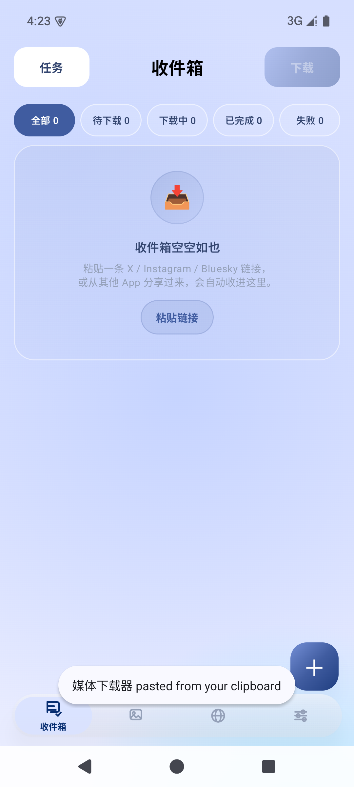
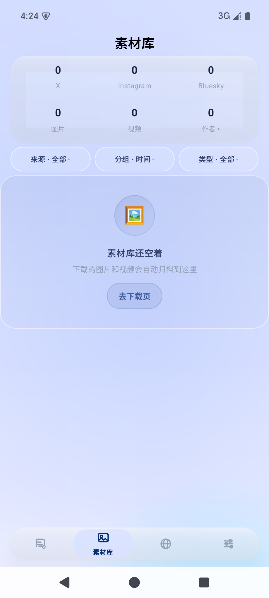
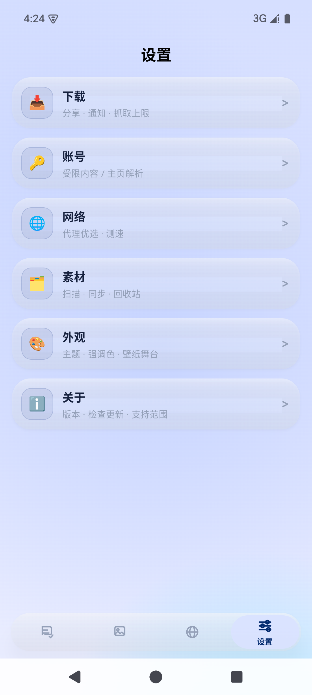
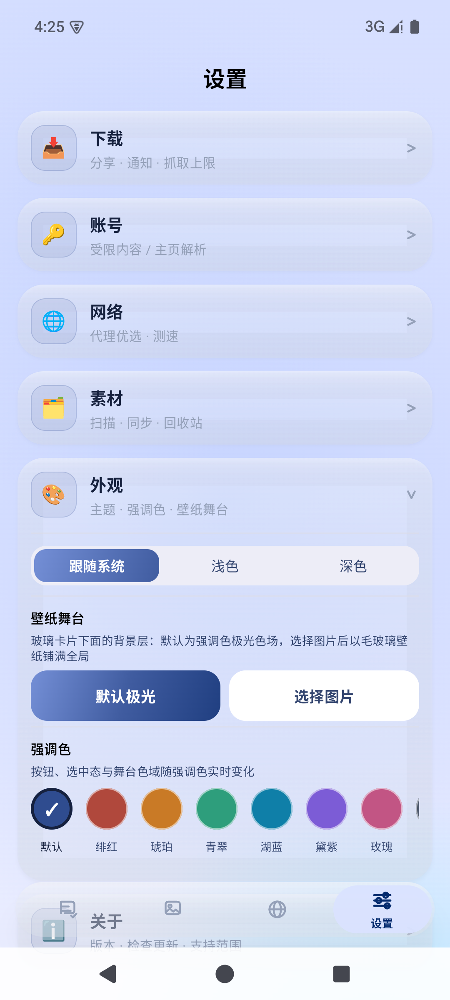
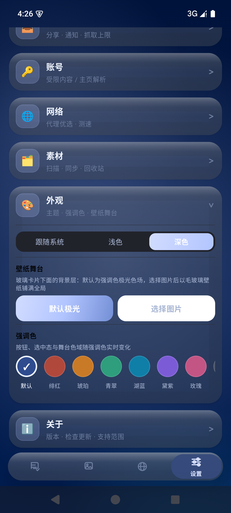
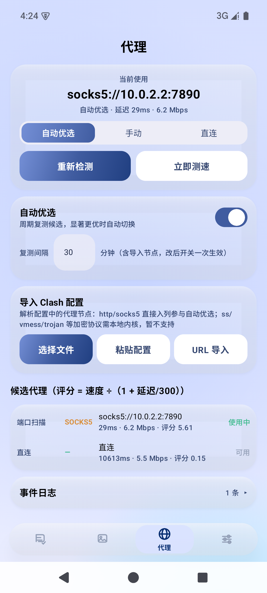

<div align="center">

# Media Downloader · 媒体下载器

**X (Twitter) / Instagram / Bluesky 图片视频下载器 — Android 原生应用**

Kotlin 2.4 · Jetpack Compose · 内嵌 yt-dlp · 代理自动优选 · 系统分享直达下载

[](#)
[](#)
[](#)
[](https://github.com/Sdhop-let/media-Download/releases/latest)
[](https://github.com/Sdhop-let/media-Download/actions/workflows/android-release.yml)
[](LICENSE)

</div>

---

## 📸 应用预览

| 收件箱 | 素材库 | 设置 |
|:---:|:---:|:---:|
|  |  |  |
| **外观 · 壁纸舞台与强调色** | **深色主题** | **代理优选** |
|  |  |  |

> **Edqiu 液态玻璃设计语言**：三层玻璃卡片浮于极光色场舞台之上，悬浮胶囊底栏随选中项变形贴合；强调色一键换肤，按钮、选中态与舞台色域全部由种子色实时派生（HCT 色彩空间）；壁纸舞台支持默认极光或自选图片毛玻璃铺底。

---

## ✨ 功能特性

### 平台支持

| 平台 | 单帖下载 | 主页批量 | 免登录 | 备注 |
|---|:-:|:-:|:-:|---|
| **X / Twitter** | ✅ | ⚠️ 实验性 | 单帖可 | 受限内容需 Cookie；主页批量走 syndication 接口 |
| **Instagram** | ⚠️ 实验性 | ⚠️ 实验性 | ❌ 需 Cookie | 移动 API，Cookie 会过期需重抓 |
| **Bluesky** | ✅ | ✅ | ✅ | 公共 API，视频走 getBlob 直下 |

### 核心能力

- **🔗 系统分享直达**：在任意 App 点「分享」选本应用 → 自动捕获链接 → 自动下载，全程零点击（可关闭）
- **📥 收件箱批量队列**：链接先捕获进收件箱（带作者 / 文案 / 预览图），可单条或自选批量下载；按 URL 去重，失败可重试；右下角 ＋ 按钮随时展开粘贴区并承接剪贴板自动捕获
- **📚 素材库**：来源 / 分组 / 类型两级筛选 + 时间网格 / 作者手风琴视图，时间线按下载时间倒序；统计面板，全屏图片查看，应用内视频播放；下载完成自动刷新，顶部胶囊一键跳转查看新素材
- **🗑 回收站**：删除走软删，可恢复或彻底清除；文件删除失败可重试，另有残留清理兜底
- **⚡ 代理自动优选**：直连 / 手动 / 端口扫描 / Clash 配置导入（文件 · 粘贴 · URL 订阅），测速评分自动选路，周期复测自动切换；主测速源异常自动换备用源重测
- **🛡 Root 代理探测**（可选）：root 设备自动识别本机透明代理与代理内核入站并参与优选；非 root 完全静默
- **🐍 内嵌 yt-dlp 引擎**：内嵌 Python 3.12 + yt-dlp，原生提取失败自动降级重试，Cookie 自动喂入
- **🍪 浏览器容器登录**：内置 WebView 登录 X / Instagram，自动抓取 Cookie（含 HttpOnly），替代手动从开发者工具抄 Cookie
- **🔄 本地导入 / 共享目录**：扫描下载目录重登记；「同步其他目录」以共享引用模式接入任意文件夹——文件留原位、仅登记元数据，文件名 / sidecar 自动识别归并，导入时间按文件真实落盘时刻沉位
- **👁 外部目录自动监控**：登记的共享目录在应用启动与后台周期（15 分钟）自动增量同步，其他 App 新下载的素材自动入库；对方目录里被清掉的文件会在下次同步时自动解除登记，素材库与磁盘始终保持一致
- **🖼 全屏同类媒体查看器**：点击素材直接打开查看页，上下滑动只浏览图片或只浏览视频；视频双击暂停，长按查看详细操作
- **🎨 外观个性化**：主题三态（跟随系统 / 浅色 / 深色）+ 壁纸舞台（默认极光色场 / 自选图片毛玻璃）+ 7 种强调色预设（默认深蓝 / 绯红 / 琥珀 / 青翠 / 湖蓝 / 黛紫 / 玫瑰），全套色板实时派生
- **🔔 版本更新检测**：设置 → 关于 → 检查更新，显示 Release 更新说明并提供 APK 下载；推送 `v*` tag 自动构建 APK 并发布 GitHub Release

---

## 📥 下载与安装

- **[下载最新 APK](https://github.com/Sdhop-let/media-Download/releases/latest)**（也可从应用内：设置 → 关于 → 检查更新）
- 要求 **Android 8.0（API 26）及以上**
- 构建为 debug 签名，已安装同签名版本可直接覆盖安装、保留数据
- 首次启动授予通知权限（用于后台下载进度通知）

---

## 🚀 快速上手

- **分享下载**：在 X / Instagram / Bluesky App 里点「分享」→ 选「媒体下载器」→ 自动进收件箱并开始下载
- **粘贴下载**：复制链接后打开 App（前台自动捕获剪贴板），或在收件箱点「粘贴链接」/ 右下角 ＋
- **批量下载**：收件箱长按进入多选，或点「任务」处理全部
- **素材管理**：底部「素材库」按时间 / 作者浏览，长按批量删除（进回收站可恢复）
- **接入已有目录**：设置 → 素材 → 同步其他目录，选中其他下载器（如 Edqiu）的保存目录即可；此后该目录的增删全自动同步，无需再手动扫描

---

## 🍪 Cookie 配置（可选，解锁受限内容）

设置 → 账号 → 「X / Twitter Cookie」或「Instagram Cookie」→ 选择**浏览器登录并自动抓取**（内置 WebView 容器，登录成功自动填入），也可手动粘贴 Cookie 文本。

> X 受限内容需要 `auth_token + ct0`；Instagram 需要 `sessionid`。Cookie 过期后重新抓取即可。

---

## ⚡ 代理配置

设置 → 网络 → 「代理优选」：支持直连 / 手动填入（http / socks5，含 `user:pass` 认证）/ 端口扫描 / **导入 Clash 配置**（文件、粘贴、URL 订阅均支持，base64 订阅自动解码）。导入后自动测速评分并优选，全程自动切换，无需干预。

> ⚠️ 加密协议节点（ss / vmess / trojan）暂不支持，导入时自动跳过。

---

## 🔨 从源码构建

```bash
# 环境要求：JDK 21 + Android SDK（API 36）+ Python 3.12（Chaquopy 构建期解释器）
cd android-app
./gradlew assembleDebug
```

- 产物默认位于 `android-app/build-epdownloader/app/outputs/apk/debug/app-debug.apk`
- 构建目录可用环境变量 `EP_BUILD_DIR` 覆盖
- Chaquopy 构建期 Python 解释器路径通过环境变量 `CHAQUOPY_BUILD_PYTHON` 指定（CI 使用 `actions/setup-python` 提供 Python 3.12）
- yt-dlp 源码已随仓库直接打包，无需构建期 `pip` 安装

### 发布新版本

1. 更新 `android-app/app/build.gradle.kts` 中的 `versionName` / `versionCode`；可附 `release/RELEASE_NOTES-<tag>.md`（缺省时 Release 说明自动生成）
2. 提交并推送 `v*` tag（例如 `v1.3.0`）
3. GitHub Actions 自动构建 APK、上传 Actions artifact，并将 APK 附加到同 tag 的 GitHub Release

---

## ⚠️ 已知限制

- 内嵌 yt-dlp 通道仅提取 http 渐进式直链（HLS / DASH 自适应流跳过）
- Instagram 接口为非官方移动 API，属实验性功能，Cookie 过期需重抓
- X 主页批量依赖 syndication 接口，限流时失败；配置 Cookie 后可降级重试
- Cookie 容器登录走系统网络（不受 App 内代理控制），需系统级 VPN / 全局代理配合
- 代理仅支持 http / socks5，加密协议节点（ss / vmess / trojan）需完整加密内核，暂不支持

---

## 🏗 项目结构

```
android-app/   Android 应用（Kotlin + Jetpack Compose，Chaquopy 内嵌 yt-dlp）
.github/       CI：推送 v* tag 自动构建 APK 并发布 Release
release/       各版本发布说明
docs/          开发文档与界面截图
```

> 开发过程记录与设计说明见 [docs/TASKS.md](docs/TASKS.md)、[docs/HANDOFF.md](docs/HANDOFF.md) 与 [docs/UI_DESIGN.md](docs/UI_DESIGN.md)。

---

## 📄 License

[Apache License 2.0](LICENSE)
